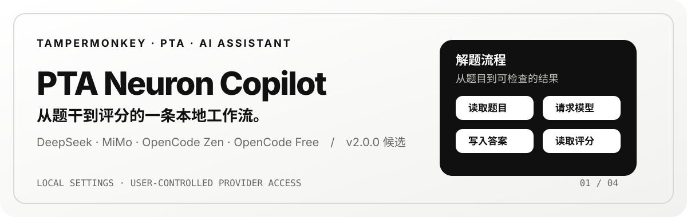
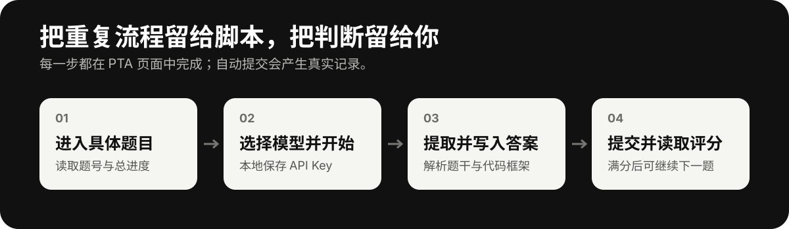

# PTA Neuron Copilot

  

  <a href="https://neuroncstate.github.io/PTA-Neuron-Copilot/">项目主页</a> ·
  <a href="https://raw.githubusercontent.com/NeuronCState/PTA-Neuron-Copilot/main/PTA%20Neuron%20Copilot-2.0.0.user.js">安装 2.0.0</a> ·
  <a href="https://github.com/NeuronCState/PTA-Neuron-Copilot/issues">反馈问题</a>

PTA Neuron Copilot 是运行在 [拼题 A（PTA）](https://pintia.cn/) 页面上的 Tampermonkey AI 辅助答题脚本，也可作为 PTA 脚本、PTA 自动答题或 PTA 自动刷题工具被检索。它读取当前题目上下文，调用你选择的 AI 供应商，把结果写入 PTA 编辑器，并在提交后读取评分。

> 当前版本：`2.0.0` · 产品名称：**PTA Neuron Copilot（PNC）** · 仅匹配 `https://pintia.cn/*`
> 仓库现为 `PTA-Neuron-Copilot`，安装链接指向 2.0.0；旧版完整归档见文末。

## 班级题集界面

以下为用户提供的 beta.20 实际截图，展示 PNC 班级分组、进度及剩余天数；图中复习开关属于旧版，2.0.0 已隐藏，不能将此图当作 2.0.0 的最终界面验收。

## 先看界面

以下为历史版本截图，可能仍显示旧名称或旧控件，不代表 2.0.0 已完成视觉验收。

  
  
  

## 它能做什么

- 从具体题目页读取题干、样例、函数接口、代码框架与裁判代码等上下文。
- 支持判断、单选、多选、填空、程序填空、函数题与编程题；多文件编程题尚未接入专用提取流程。
- 为编程题生成代码，写入 PTA 编辑器，提交后等待评分并读取结果。
- 非满分时最多自动重答 1 次；开启“连续答题”后，满分会进入下一题。
- 提供自动检测、C、C++、Python、Java、Pascal 五种语言选择。
- 统一控制脚本面板与 PTA 页面的浅色 / 深色主题，并展示真实题目进度与运行记录。
- 支持最小化为 58px PNC 悬浮胶囊，保留彩色运行光效；任务执行期间提供柔和的中轴自转混色流光与文字处理状态指示。

## 解题流程

  

自动提交会在 PTA 中留下真实提交记录。首次使用建议关闭“连续答题”，先检查生成的代码和评分，再决定是否连续处理。

## 3 分钟开始使用

1. 安装浏览器扩展 [Tampermonkey](https://www.tampermonkey.net/)。
2. 打开[已发布 beta.20 固定版本](https://raw.githubusercontent.com/NeuronCState/PTA-Neuron-Copilot/main/PTA%20Neuron%20Copilot-2.0.0.user.js)，核对管理器显示版本后安装。2.0.0 发布前，不把此链接当作新版安装入口。
3. 在 Tampermonkey 确认安装，刷新 PTA 页面。
4. 登录 PTA 并进入**具体题目页面**；右下角会出现脚本面板。
5. 点击面板右上角设置，选择供应商、填写 API Key、等待模型列表加载（设置项实时自动保存，无需手动保存），然后点击“测试”。
6. 在首页确认编程语言与开关，点击“开始解题”。需要停止时点击“停止解题”。

如果浏览器没有自动跳到安装页，可在 Tampermonkey 控制面板选择“添加新脚本”或“导入”，再导入 `.user.js` 文件。

## 模型与配置

| 供应商 | 定位与描述 | 图片输入默认值 | 鉴权方式 | 特性 |
| --- | --- | --- | --- | --- |
| DeepSeek | 全能快速模型 | 关闭（可开启） | Bearer Token | 官方 API 直连 · 代码生成与逻辑推导准确迅速 · 支持图片输入 |
| MiMo | 全能性价比模型 | 开启 | `api-key` 请求头 | 小米官方高性价比推理模型 · 视觉多模态与长上下文 |
| Opencode Zen | 免费模型 | 关闭（可开启） | Bearer Token | Opencode 官方网关 · 内置免费模型（`*-free`、`big-pickle`）置顶展示 |
| OpenCode Free | 本地免费模型 | 关闭 | 本地 Bearer Token（可选） | 自动探测 `127.0.0.1:8788` · 本地服务免外网 Key · 仅展示 Free 模型 |

模型名称不会固定写死：填写 API Key 后，脚本请求对应的 `/models` 接口并展示可用模型。Opencode Zen 的 Free 模型（`*-free`、`big-pickle`）会优先显示，并在名称后标注 `· Free`，支持图片输入取决于模型能力。DeepSeek 已开放图片输入开关，可自行开启。启动 OpenCode Free 本地代理后，脚本会自动探测端口并显示该供应商，Token 未设置时可以留空。

API Key 仅保存在当前浏览器的本地配置中；脚本不将 Key 上传到自建服务器，但会按所选供应商 API 的要求发送给该供应商。

### 常用选项

- **跳过已作答**：不处理已经填入答案的题目。
- **连续答题**：本题满分后进入下一题。
- **自动检测语言**：依据题目标题、接口与代码内容判断；也可手动指定 C、C++、Python、Java 或 Pascal。
- **主题切换**：面板顶部月亮 / 太阳按钮会同步切换 PTA 页面、面板、设置抽屉与下拉框主题；选择会在浏览器中保存。

- **Max Token 视觉分级调节**：自动根据所选模型的上下文上限动态适配滑动范围（2K ~ 1M），并提供阶梯预设与模型最大上限标注。
- **思考强度（Thinking）分级**：支持 0 级（关闭）、1 级（低 · 快速）、2 级（中 · 推荐）、3 级（高 · 深度推理），满足不同题型的推理深度需求。
- **实时自动保存**：设置面板内的任何变更（密钥、模型、开关与滑动条）均在操作瞬间自动持久化至当前浏览器，无需手动点击保存。

## 支持范围

| PTA 题型 | 支持情况 |
| --- | --- |
| 判断题、单选题、多选题、填空题 | 支持 |
| 程序填空题、函数题、编程题 | 支持 |
| 多文件编程题 | 暂未接入专用提取流程 |

## 常见问题

<strong>模型列表为空</strong>

确认 API Key 完整且供应商选择正确，再点击“刷新模型”。无效 Key 的错误会显示在设置页和运行记录中。

<strong>AI 返回为空或只有推理内容</strong>

部分思考型模型可能消耗大量输出预算，只返回 `reasoning_content` 而没有最终答案。可更换模型或重新测试连接。

<strong>进度一直显示“等待开始”</strong>

请确认打开的是具体题目页而非题目集概览页。脚本从 PTA 题目导航读取总题数和当前题号。

<strong>脚本没有显示</strong>

检查 Tampermonkey 是否启用、网址是否为 `https://pintia.cn/`、页面是否已刷新，以及是否安装了最新版脚本。

<strong>深色模式页面颜色异常</strong>

深色模式会统一处理 PTA 页面，同时尽量保留普通图片和视频的原始观感。个别 PTA 弹层或第三方组件使用独立样式，刷新页面后通常可恢复。

## 权限与验证

脚本使用 `GM_xmlhttpRequest` 请求模型列表和聊天接口，使用 `GM_setClipboard` 在编辑器无法直接写入时复制答案到剪贴板；仅允许连接 `api.deepseek.com`、`api.xiaomimimo.com`、`opencode.ai` 以及本地代理 `127.0.0.1:8788`（localhost）。

- JavaScript 语法检查已通过。
- 当前 2.0.0 以离线回归为准；尚未进行真实 PTA、收费模型和脚本管理器升级验收。历史版本的单题成功结果不代表本版或其他题目必然正确。

## 项目主页与更新

`docs/` 是 GitHub Pages 的静态源文件，发布地址为 <https://neuroncstate.github.io/PTA-Neuron-Copilot/>。仓库设置中选择 **Settings → Pages → Deploy from a branch → `main` / `/docs`** 即可启用。

如果 Pages 当前选择的是 `main` / `/(root)`，仓库根目录也提供了入口，会自动跳转到 `docs/`。若仍显示 404，请在 **Settings → Pages** 确认已经选择发布源；仅提交网页文件不会自动开启 GitHub Pages。

脚本元数据已配置 `@updateURL` 和 `@downloadURL`；发布新版本后，Tampermonkey 可以从仓库原始脚本地址检查更新。

## 2.0.0 升级与兼容说明

- **显示名称**为 PTA Neuron Copilot，缩写 PNC。为保留既有 Beta 安装身份，管理器 `@name`、`@namespace`、原脚本文件名和存储键暂不更改；管理器显示旧名属于预期。不要另装一份新身份脚本与旧版并行运行。
- **复习功能暂隐藏、暂停**：不显示开关、题集入口或本地复习控件，不自动后台获取复习题目；不删除已有持久复习缓存。不是“复习已完成并正式上线”。
- **开发者选项暂隐藏、暂停**：不显示诊断开关或导出入口，不继续页面/API 诊断采集。已有内存诊断数据并非持久缓存，本来就会随刷新消失，不能承诺跨刷新保留。
- API Key、题集缓存与 AI 解答缓存沿用原设置和身份；未保存的 PTA 页面代码、输入和临时本地草稿不在自动恢复保证范围内。
- 从 Beta 升级前，确认只启用一份脚本，并记录自己需要保留的设置；更新后先在普通练习页检查供应商配置、历史缓存和版本，再进行实际作答。测试不等于真实 PTA 全流程验收。
- 旧正式版与 Beta 可能是不同管理器安装身份。不能承诺把旧正式版的所有 GM 存储无损转入 Beta；不要通过更改 `@name` 强行迁移。

## 仓库和网站迁移

仓库已更名为 `PTA-Neuron-Copilot`。当前安装、反馈、canonical 和 sitemap 统一使用新地址，Pages 地址为 <https://neuroncstate.github.io/PTA-Neuron-Copilot/>。旧仓库跳转与旧 raw 更新路径需要分别核验，不能把仓库重定向当作 Pages 重定向。

GitHub [官方重命名说明](https://docs.github.com/en/repositories/creating-and-managing-repositories/renaming-a-repository)明确：项目 Pages URL 不会自动重定向。请更新网页书签；不要重新创建同名旧仓库，否则旧仓库重定向会失效。网站源文件仍为 `docs/`，根入口跳转到 `docs/`；真实 Pages 发布源和构建状态应以仓库设置为准。

## 旧脚本保留与回退

- 原有 `PTA Auto Solver Pro-1.4.2.user.js`、`1.6.0`、`1.8.0` 历史文件原样保留。
- 新增 [beta.20 完整归档](./legacy/PTA-Auto-Solver-Beta-1.8.1-beta.20.user.js)，与已发布提交 `e8739cfcc2553d637791fd351d80f67c4f00c344` 的脚本逐字节相同，未删减代码或改写元数据。
- 旧路径 `PTA Auto Solver Pro-1.8.1-beta.1.user.js` 是现有 Beta 的更新通道，提供 2.0.0；不是永久冻结的旧版副本。旧版已另存到上述归档，Git 历史也保留。
- 升级优先在原管理器条目检查更新，不卸载、不同时运行两份。若手动回退 beta.20，它原样保留的更新地址仍会指向更新通道；想固定旧版，需在脚本管理器关闭该条目的自动更新。管理器对降级可能提示确认；尚未实际验收。
