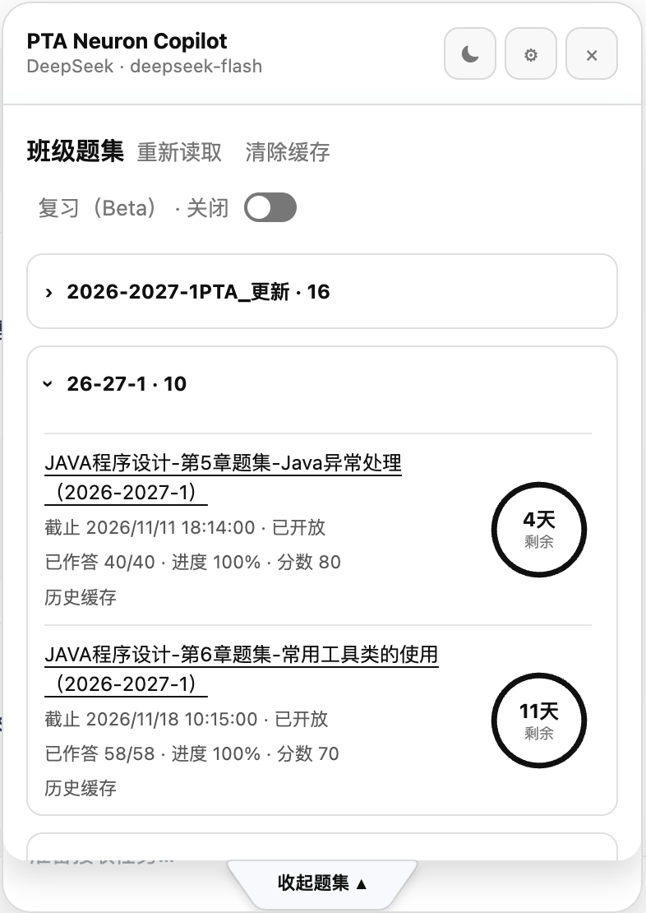

# PTA Neuron Copilot

**PNC · 2.0.0**：面向[拼题 A（PTA）](https://pintia.cn/) 的 AI 辅助答题脚本，支持多模型、小题并发、解析辅助、班级题集管理与本地缓存。

[安装 2.0.0](https://scriptcat.org/zh-CN/script-show-page/7287) · [项目主页](https://neuroncstate.github.io/PTA-Neuron-Copilot/) · [使用指南](https://neuroncstate.github.io/PTA-Neuron-Copilot/guide.html) · [反馈问题](https://github.com/NeuronCState/PTA-Neuron-Copilot/issues)

需要 [脚本猫](https://docs.scriptcat.org/) 或 [Tampermonkey](https://www.tampermonkey.net/) 用户脚本管理器，仅运行于 `https://pintia.cn/*`。仓库已更名为 `PTA-Neuron-Copilot`，请使用上方新主页。

## 界面

*用户提供的 beta.20 截图；图中的复习开关在 2.0.0 已隐藏。下方为历史版本界面，可能显示旧名称或控件。*

  
  
  

## 升级与旧版

- 已安装 Beta 的用户请在原管理器条目检查更新，不先卸载，也不要同时启用两份。管理器保留旧名称和身份，API Key、设置及缓存沿用原存储；不同旧正式版身份之间不保证自动迁移。
- 文件名含 `beta.1` 的[兼容入口](./PTA%20Auto%20Solver%20Pro-1.8.1-beta.1.user.js)内容已是 **2.0.0**，用于让旧用户正常升级，不是冻结旧版。
- 旧脚本原样保留：[1.4.2](./PTA%20Auto%20Solver%20Pro-1.4.2.user.js) · [1.6.0](./PTA%20Auto%20Solver%20Pro-1.6.0.user.js) · [1.8.0](./PTA%20Auto%20Solver%20Pro-1.8.0.user.js) · [beta.20 完整归档](./legacy/PTA-Auto-Solver-Beta-1.8.1-beta.20.user.js)。若固定使用旧归档，请在管理器关闭该条目的自动更新。
- 复习功能暂隐藏、开发者选项暂隐藏，相关后台任务暂停，不删除已有持久缓存。未保存的网页输入和代码不保证刷新恢复；升级后请先在普通练习页检查。

脚本会把题目发送给你选择的模型供应商，并按其要求使用 API Key；Key 保存在本地，缓存使用脚本私有存储，部分操作会使用剪贴板。自动提交会留下真实 PTA 记录，AI 答案可能有误，请遵守课程与平台规则。
